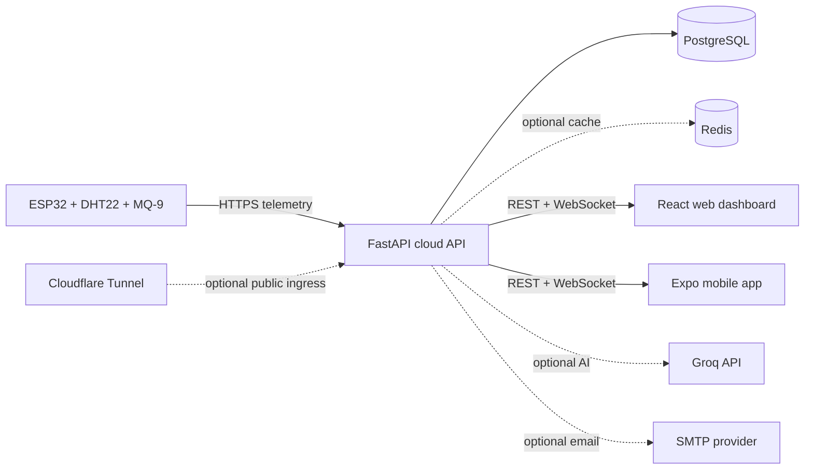

# Aera

Aera is an air-quality monitoring project that connects an ESP32 sensor station to a cloud API and presents its readings in browser and mobile applications. It combines device telemetry, account and device management, historical readings, live updates, and general air-quality guidance.

**Project:** [aera.hacksmiths.dev](https://aera.hacksmiths.dev) · **API:** [aera-cloud.hacksmiths.dev](https://aera-cloud.hacksmiths.dev) · **Maintainer:** [HackSmiths](https://hacksmiths.dev) · [contact@hacksmiths.dev](mailto:contact@hacksmiths.dev)

> **Important:** Aera is an environmental monitoring and informational project, not a certified gas detector, life-safety system, or medical device. Sensor estimates and generated guidance are not a substitute for calibrated instruments, emergency alarms, or professional advice.

## How the system fits together



The ESP32 assigns itself a device ID, reads temperature, humidity, and an MQ-9-based CO estimate, and posts telemetry to the cloud. The backend validates and processes readings, stores them in PostgreSQL, calculates an air-quality category, and broadcasts updates to connected clients. Users can sign in, view readings, manage devices, and request general air-quality guidance.

The current firmware does not include a particulate-matter sensor; it reports PM2.5 and PM10 as zero. MQ-9 gas concentration is an estimate and requires appropriate sensor warm-up, calibration, and validation for its environment.

## Repository components

| Path | Role | Component guide |
| --- | --- | --- |
| [`aera-aqi/`](./aera-aqi/) | ESP32 firmware, sensor wiring, Wi-Fi provisioning | [Firmware README](./aera-aqi/README.md) |
| [`aera-cloud/`](./aera-cloud/) | FastAPI API, PostgreSQL persistence, telemetry processing | [Backend README](./aera-cloud/README.md) |
| [`aera-web/`](./aera-web/) | React browser dashboard | [Web README](./aera-web/README.md) |
| [`aera-app/`](./aera-app/) | Expo / React Native mobile application | [Mobile README](./aera-app/README.md) |
| [`_DOCS/`](./_DOCS/) | Project documents | — |

## Run with Docker Compose

Docker Compose starts the cloud API, static web app, and Cloudflare Tunnel connector. PostgreSQL is **not** included; configure a database that the backend can reach. Redis, Groq, and SMTP are optional integrations.

### Prerequisites

- Docker Engine and the Docker Compose v2 plugin
- A PostgreSQL database and connection string
- A Cloudflare Tunnel token for the full Compose stack (optional if starting only the API and web app)

### Configure and start

1. Create local environment files:

   ```sh
   cp .env.example .env
   cp aera-cloud/.env.example aera-cloud/.env
   ```

2. Edit `aera-cloud/.env`:
   - Set `DATABASE_URL` to a reachable PostgreSQL database. The example's `localhost` points to the backend container itself when using Docker. For a database running on your Mac/PC, use `host.docker.internal`; for a hosted database, use its connection string.
   - Replace `SECRET_KEY` and `DEVICE_PRESHARED_KEY` with strong, unique values. Configure the firmware with the matching device key before connecting a device.
   - Configure optional Redis, Groq, and SMTP values only if you use those integrations.

3. Set `CLOUDFLARE_TUNNEL_TOKEN` in the root `.env` to start the tunnel. It is not required when starting only the backend and web services.

4. Start the services:

   ```sh
   # API, web app, and Cloudflare Tunnel
   docker compose up --build -d

   # API and web app only (no tunnel)
   docker compose up --build -d aera-cloud aera-web
   ```

5. Apply the database schema:

   ```sh
   docker compose exec aera-cloud alembic upgrade head
   ```

6. Open the dashboard and confirm the API is healthy:

   - Web dashboard: <http://localhost:5175>
   - API health: <http://localhost:8085/health>
   - Interactive API documentation: <http://localhost:8085/docs>

The public dashboard is [aera.hacksmiths.dev](https://aera.hacksmiths.dev), and the API is [aera-cloud.hacksmiths.dev](https://aera-cloud.hacksmiths.dev). The tunnel forwards traffic according to the ingress rules configured for that tunnel in Cloudflare. To serve the dashboard through a public hostname, set the root `VITE_API_URL` to `https://aera-cloud.hacksmiths.dev` and `VITE_WS_URL` to `wss://aera-cloud.hacksmiths.dev` before building. Vite embeds these values into the static bundle at image-build time; rebuild `aera-web` after changing them:

```sh
docker compose up --build -d aera-web
```

Common operations:

```sh
docker compose ps
docker compose logs -f aera-cloud aera-web
docker compose down
```

The database is external to Compose, so `docker compose down` does not remove database data.

## Run components without Docker

### Backend

Use Python 3.13 or newer. Create and edit `aera-cloud/.env` as above, ensuring PostgreSQL is running and `DATABASE_URL` is reachable from your host:

```sh
cd aera-cloud
python3 -m venv .venv
source .venv/bin/activate
pip install -r requirements.txt
alembic upgrade head
uvicorn main:app --reload --host 0.0.0.0 --port 8085
```

The API is available at <http://localhost:8085>; interactive docs are at <http://localhost:8085/docs>.

### Web dashboard

Use Node.js compatible with Vite 8 and npm. The committed `aera-web/.env.example` points to a backend on the same computer:

```sh
cp aera-web/.env.example aera-web/.env
cd aera-web
npm ci
npm run dev
```

Vite prints the dashboard URL when it starts (port 5175 by default). `VITE_API_URL` and `VITE_WS_URL` in `aera-web/.env` select the API and live-update endpoints. For a phone or another computer, do not use `localhost`; use an address reachable from that client.

### Mobile app

Use Node.js, npm, and the Expo tooling required by the installed Expo SDK:

```sh
cd aera-app
npm ci
npm start
```

Follow the Expo CLI prompts to launch on a simulator or device. The app uses [aera-cloud.hacksmiths.dev](https://aera-cloud.hacksmiths.dev) by default. For local development, update the API base URLs in `aera-app/src/services/api.js`; use a network-reachable host when testing on a physical device. See the [mobile guide](./aera-app/README.md) for details.

### ESP32 device

Install the Espressif ESP32 board support and the Adafruit DHT sensor library in Arduino IDE, then open `aera-aqi/aera-aqi.ino` from the project folder and build/upload for the ESP32 board in use. Wire the DHT22 and MQ-9 as described in the [firmware guide](./aera-aqi/README.md). On first boot, connect to the device's temporary `Aera-...` Wi-Fi network and provision a 2.4 GHz network through `http://192.168.4.1`.

## Environment files and secrets

- Root `.env`: Compose settings for the tunnel token and web API URLs.
- `aera-cloud/.env`: backend settings, including the database URL, JWT key, device key, and optional integrations.
- `aera-web/.env`: Vite development settings; production web images use the root Compose build arguments instead.
- `.env` files are ignored by Git. Keep credentials out of source control and replace all example values before deploying. The mobile API URL and firmware endpoint/key are currently configured in source; treat those files as deployment-specific configuration and do not publish private credentials.

See each component README for its configuration details. The repository is licensed under the [MIT License](./LICENSE).

## Verification

From `aera-cloud/`, run backend tests with `pytest` against a **disposable test database** configured for the suite. Do not point tests at production data. From `aera-web/`, run:

```sh
npm test
npm run lint
npm run build
```

From `aera-app/`, run its Jest/React Native test suite with `npm test`. From `aera-web/`, `npm test` runs the Vitest suite. The suites include focused coverage for registration and login state, password-reset verification codes, password visibility, and device unlink state, in addition to unit/component checks. These automated tests use mocked client services and do not replace deployed API, email-delivery, hardware, or end-to-end environment checks. Both JavaScript clients also support `npm run test:watch` for interactive development. Test coverage output is local and ignored by Git.

Check the Expo app configuration and SDK-compatible package versions from `aera-app/` with:

```sh
npx expo-doctor
```

Docker Compose can validate service configuration with `docker compose config`. Firmware must be compiled and tested on the intended ESP32 hardware; this repository does not include an automated firmware test suite.

## Contact

For project questions, contact [contact@hacksmiths.dev](mailto:contact@hacksmiths.dev) or visit [hacksmiths.dev](https://hacksmiths.dev).
